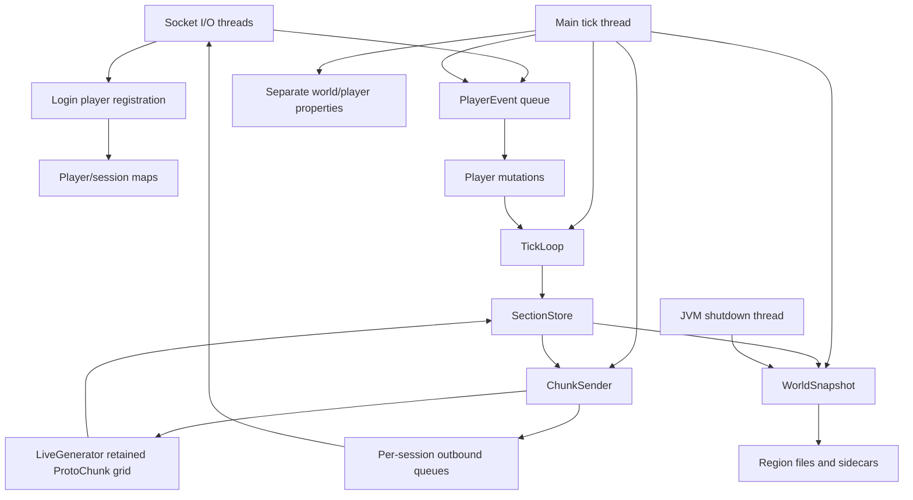

# Kestrel architecture audit

Date: 2026-09-17. Source revision: `48b74005c3e627d09896be517d3d19336c9c3ea1`.

Status notes dated after the audit (first added 2026-09-18, latest 2026-09-28) are annotations on individual findings; each names its evidence commits. The body text, including the section 2 architecture map and every "Line numbers below are as audited" block, remains the 2026-09-17 audit of `48b7400`. Where a dated status note overlaps a body claim, the status note is the current one.

## 1. Executive verdict

**Safe only after specific blockers are resolved.** The storage and embedded-vanilla approach does not need wholesale replacement. The current live server does need architectural repair before additional systems depend on its chunk lifecycle, mutation boundary, persistence, or scheduler.

The most urgent problems are concrete:

1. Generating a neighboring chunk can restore mined terrain or overwrite player replacements.
2. Saving has no recoverable commit across region data, sidecars, and player/world state. Shutdown can save concurrently with the tick thread or another save.
3. Reload upgrades partially generated margins into completed chunks without running their remaining generation.
4. The live gameplay path is still a fixture-oriented model. It drops scheduling and mechanics that component proofs and public status tables can make appear implemented.

Memory optimization cannot safely proceed by simply evicting `LiveGenerator.grid`. The grid currently holds both generation dependencies and state absent from Kestrel's durable model. Nor does removing the grid bound the resident `SectionStore`, diagnostic traces, or disconnected-player stream state.

Continue immediately with focused reproduction gates and architecture repair. Postpone parallel ticking and public plugin APIs. Lighting and biome/heightmap implementation can be researched independently, but integration must wait for an explicit complete-chunk handoff and mutation contract.

### Audit basis and limits

This was a read-only audit. No build, gameplay test, server connection, restart, stop, forced GC, or fault-injection experiment was run. The pre-existing modification to `logs/latest.log` is runtime state and was left alone.

Sources examined include the repository README, running, events, vision, benchmark, generation, memory, and tick design documents; implementation and check programs; and recent Git history. Historical notes were treated as claims to check, not specifications that override parity.

Important evolution: `b3e9df9` introduced persistence/async-saving support; `f362dac` wired the live shell; `5eafd11` attached generation on loaded boots; `ec03d79` and `dd399c8` added compact import/handoff/snapshots; `de82001` released NoiseChunk scratch; `48b7400` separated RSS results from latency acceptance. Several present defects sit at those integration boundaries rather than inside the isolated optimizations.

The durable 1,024-row batch CSV was inspected and its summary counts reproduced by reading it: 245 P2 blocks matches, 913 P2 full matches, four exact P3 order-1 matches, and 49 cross-order exact matches. These are **September 14 historical results**, not a new run of this revision. The two-seed NoiseChunk A/B report was inspected as historical targeted evidence, not independently rerun. Local vanilla 26.2 bytecode was inspected with `javap` for `LevelChunkTicks.schedule` and `LeavesBlock.getOptionalDistanceAt`.

A read-only `systemctl --user show` of the live service reported it active with the documented G1/256 MiB flags, world `$HOME/kestrel-run/play/world`, seed `4242424242`, a transient user unit, `KillMode=control-group`, and `TimeoutStopUSec=1min 30s`. This establishes launch settings, not that the running classes match every source byte in this revision.

Evidence labels below distinguish **confirmed defects**, **strongly supported risks**, **measurement questions**, and **intentional scaffolding**. “Reproducible by path” means the source establishes a deterministic mechanism, not that this audit executed a reproduction. Line references are relative to this revision. Java paths abbreviated below begin at `core/src/vanilla/java/dev/kestrel/`.

## 2. Architecture map

### Runtime owners and state flow

| Component | Actual responsibility and ownership |
| --- | --- |
| `net/KestrelServer` | Boots vanilla registries and a headless generator, creates one Overworld level/loop, loads or generates blocks, loads player/clock state, starts sockets, runs the main tick and synchronous saves. |
| `loop/KestrelLevel` | Owns `SectionStore`, a sleeper registry, and position/type block-entity records. It is not a vanilla `ServerLevel`; block-entity records contain no gameplay payload. |
| `loop/SectionStore` | Authoritative live block cells, compact or dense by section. Also owns an in-memory set of chunks whose own FEATURES pass ran. It has no ordinary chunk residency/unload lifecycle. |
| `loop/TickLoop` | As audited: narrow redstone dispatch, scheduled torch/repeater bodies, per-world signal/cache state, event hooks, and an accumulating power trace; its block-entity body is a no-op. **Status 2026-09-25:** G12 landed full neighbor dispatch and the redstone engine here (wire, torches with burnout, repeaters, comparators, observers, levers, buttons, lamps, pistons, the block-event queue and moving pistons; `RedstoneParityCheck` 29/29 exact, `024ed43`, `3f0f7a3`, `db4aff8`, `8091127`), G11 added fluid flow, the tick phases are documented in `TickLoop.tick()`, and the power trace is capped at 1024 lines and off by default. |
| `worldgen/LiveGenerator` | Owns a never-evicted map of vanilla `ChunkAccess`/`ProtoChunk` objects. These contain another copy of terrain plus biomes, heightmaps, generation tick containers, and other metadata. |
| `worldgen/HeadlessNoise.Driver` | Seed, vanilla generator, `RandomState`, registries, fixed Overworld geometry, and a structures-disabled manager. The separate structural probe is not the live generation pipeline. |
| `net/NetServer` | Socket/session lifecycle, packet parsing, inbound event queue, player maps, saved-player map, weather/daytime, and one set of chunk revisions. Login I/O still performs some player/world work. |
| `net/ChunkSender` | Reads live sections, triggers generation during serialization, owns per-profile sent sets and another revision map, and enqueues chunk packets. |
| `persist/*` | Snapshot block cells/written flags, narrow queue and sleeper records; encode Anvil plus authoritative `.kex` sidecars. `StateStore` separately stores clock/weather and player position/held-slot properties. |

The extra shutdown-to-snapshot edge is currently unsafe. Likewise, the generator-to-store edge can overwrite live state, and login registration is outside the intended tick owner.

### Generation flow

`ChunkSender.sectionBytes` calls `ensureChunk` if the store's completion set lacks the center. `LiveGenerator.ensureChunk` generates the 3x3 margin through noise, vanilla surface, and carvers, sets `CARVERS`, and releases each memoized `NoiseChunk`. It runs FEATURES only for the requested center, then settles leaf distance in the center 3x3 using whatever of a 5x5 is cached. It republishes all nine chunks to `SectionStore` and marks only the center complete.

The dynamic `RegionView` delegates supported vanilla feature reads/writes into that grid. FEATURES can write through both `setBlock` and direct section access. Unsupported template access returns a null server level; feature exceptions are logged and skipped. `addFreshEntity` returns success without retaining the entity. Tick containers and postprocessing markers exist in the proto objects, but block-only handoff does not transfer them to the live loop.

As audited, the live path used structures OFF. `loadStructural`/`structures` prove a separate STRUCTURE_STARTS slice; references, terrain adaptation, piece placement, and durable structures are not integrated. The full structure dependency envelope therefore cannot be inferred from the present radius-1 feature window. **Status 2026-09-25:** the live path is no longer structures-off: `KestrelServer` loads `HeadlessNoise.loadStructural` for every boot and constructs the live generator from it (`net/KestrelServer.java:178-190`, logging `live generator structures=on`), so STRUCTURE_STARTS, references and piece placement run on the live path and structure data is round-tripped through generation (`LiveGenerator.structuresEnabled()`).

### Persistence flow

At boot, normal load decodes every region into dense cells, combines sidecar written flags, sleeper records and queue entries, then restores the loop. `KestrelServer` derives generated markers from the presence of restored sections. Import is a separate block-only compact path with saving disabled, no block entities, no restored tick queue, and no completion markers.

Every 6,000 main-loop iterations, or a console save request, the tick thread captures a full snapshot and synchronously writes every touched chunk. Each region handle is opened/closed per chunk, with `force(true)` on close. Sidecars are overwritten afterward. Player and clock properties are then written separately. There is no checkpoint manifest or globally exclusive world writer. `AsyncSaver` exists, but the live entry point does not use it.

On shutdown, a different JVM thread sets a stop flag and immediately performs the same save without waiting for the current main-loop iteration. A normal sidecar CRC/geometry check detects some damage; it does not recover an interrupted checkpoint.

### Network and tick flow

Main-loop order is `loop.tick()` then inbound-event drain then `netServer.tick(sender)` then disconnect cleanup then possible save, followed by wall-clock pacing. Inside `loop.tick`, the narrow scheduled queue drains, sleepers are walked, neighbor dispatch drains, a trace line is retained, and gameTime increments. Network ticking advances weather/daytime, performs staged joins, streams chunks, and handles keepalives.

I/O threads parse events and drain outbound packet queues. The inbound drain takes an initial event-count budget, with per-session admission protections. Outbound queues are unbounded and batch acknowledgments do not control streaming. Player records and session maps are concurrent maps, but mutable player state and `SectionStore` do not thereby become thread-safe.

Network chunks contain live block states, one constant biome, no heightmaps or block entities, and full sky light. Persistence separately synthesizes plains, a limited heightmap, empty structures, and no fluid ticks. There is no common authoritative chunk metadata object joining these views.

### Vanilla boundary

Real vanilla `BlockState`, registry, palette, collision-shape, noise, biome-source, surface/carver and placed-feature classes are valuable dependencies. Kestrel owns storage, scheduling, transport and a growing set of mechanic transcriptions. The existence of vanilla classes does **not** mean vanilla `ServerLevel` tick behavior is running.

`KestrelPos`/`KestrelState` provide a useful facade direction, but public `store()` access and vanilla-typed overloads remain available. Reflection/proxies are localized adapters, not a complete vanilla world implementation. Parallel noise workers have a separate scoped design; their equality results do not establish thread safety of live ticking or neighbor-writing FEATURES.

## 3. Preserved invariants

- Section addressing consistently uses 16x16x16 cells and `(y << 8) | (z << 4) | x`, with explicit world-section versus chunk-slot conversion. Retain negative-Y regression coverage.
- Dense storage distinguishes explicitly written air from an unwritten cell. This is valuable provenance; do not erase it during demotion or use “non-air” as a universal dirty-bit substitute.
- Compact palette/data validation and copy-on-write promotion preserve current cells. Existing internal mutation paths replace compact representation instead of modifying its shared arrays.
- Snapshot capture copies dense cells/written flags before background use and can share compact arrays under the current ownership contract. Preserve the split between capture and serialization.
- Sidecar authority over written flags, sleeper registration and the modeled queue is explicit. Normal load rejects missing sidecars and inconsistent geometry rather than silently merging an incomplete world.
- Per-world redstone signal suppression avoids changing the JVM-global vanilla wire singleton. Keep this ownership boundary.
- Chunk-stream overlap is retained and out-of-view per-player entries are pruned on center changes. Do not return to retransmitting a whole view on every chunk step.
- The absent-section encoding fast path uses a constant with isolated returned bytes; populated sections reuse tick-confined scratch fully overwritten before encoding.
- Real vanilla codec decoding in `PlayShapeCheck`, and parser/continuation checks in `PersistCheck`, are meaningful within their scope. They should survive changes to implementation layout.
- The no-subscriber event mask and stable listener registration order are sound concepts. Event-instance lifetime needs repair, not replacement of the entire mechanism.

These are code-level invariants and inspected test designs, not a claim that the audit reran the checks.

## 4. Ranked findings

### Critical: confirmed defects and severe active scaffolding

#### C1. Generation can overwrite player edits, including saved edits

> **Status 2026-09-18: FIXED** (`058f1cb`). Adjacent chunk generation republishing its 3x3 margin no longer overwrites player modifications; `SectionStore` records per-cell mutation provenance (`edited` bitset, KEX3/KEX4). Gate: `TerrainOverwriteCheck` passes. Line numbers below are as audited.

**Evidence and path:** `worldgen/LiveGenerator.java:77-114` republishes the whole 3x3 after a new center. `HeadlessNoise.java:1217-1250` unconditionally replaces a compact section; for a dense section it skips only generated air and calls `store.set` for every generated non-air cell. `SectionStore.java:143-156` has no generation conflict check. Only the requested center's generated marker is checked, not the neighbors being rewritten.

**Violated invariant:** published player/simulation state must not be replaced by an older generation copy. Storage representation is not mutation provenance.

**Failure and effect:** generate A, mine a natural solid in A, then generate adjacent B. A's retained solid is copied back over the mined air. Replacing natural terrain is similarly undone. After reload, the empty generator grid reconstructs A's natural terrain when A is needed as B's margin, even though A is marked generated in the live store. This can overwrite saved builds too. Feature-generated air cannot clear stale dense cells either, so the merge is not a general generation-delta application.

**Disproof attempted:** the generated guard protects only direct requests for A. The dense merge protects blocks placed in original air, which is exactly the narrow case tested at Y=300 in `net/LiveGeneratorCheck.java:92-127`; it does not protect mining or replacements. Written flags are not consulted, and even those flags currently include generated non-air rather than identifying player edits.

**Confidence/status:** high; confirmed deterministic mechanism, not reproduced during this audit.

**Smallest verification:** generate A; mine one original solid and replace another; generate B; assert both edits. Repeat across save/reload and with compact/dense sections. Require equality between authoritative cells, sent cells and saved cells. Choose a publication/ownership rule before implementing the fix.

#### C2. An interrupted save has no consistent recoverable checkpoint

> **Status 2026-09-17: PARTIALLY RESOLVED** (`a634305`). Boot takes an exclusive `FileChannel.tryLock` on `<worldDir>/.kestrel.lock` before region access or socket bind, released on shutdown. Atomic multi-region/sidecar transactional commit remains open. Line numbers below are as audited.

**Evidence and path:** `persist/WorldStore.java:77-110` writes chunks first, then directly overwrites each sidecar with `Files.write`. `RegionFile.java:145-176` writes payload/header and forces only on close. `WorldStore.load:141-149` requires matching sidecar clocks. `net/KestrelServer.java:362-364` writes player/world properties afterward. `StateStore.java:114-123` uses per-file rename, a fixed temp name, no explicit file/directory force, and a non-atomic fallback.

**Violated invariant:** recovery must select a consistent committed generation of block data and the metadata that gives those blocks meaning. Multiple region/header/sidecar writes and player records are not one commit.

**Failure and effect:** a crash after some new chunk writes leaves old written flags/queues with new blocks; after one sidecar publication it can leave incompatible clocks across regions; during direct sidecar replacement it can destroy the only valid sidecar. Boot then rejects the world or restores mixed state. A separately newer player position can also disagree with durable terrain. A five-minute autosave cadence may define a recovery window, but it must not destroy the previous recoverable checkpoint.

**Disproof attempted:** CRC checks detect damage; they cannot restore the previous copy. New-sector allocation helps individual writes but there is no durable publication ordering or world-level transaction. Atomic properties rename is useful per file, not cross-file atomicity. No world-root lease prevents two instances using different ports from loading/writing the same world before socket bind; shell preflight is not that invariant.

**Confidence/status:** high; confirmed absent protocol. Particular crash outcomes require fault injection; no claim of current live corruption.

**Smallest verification:** two regions plus one player and scheduled change, with termination/I/O failure after each publication boundary. Recovery must yield a documented consistent checkpoint, retain a recoverable predecessor on failed saves, and reject a second writer before it accesses mutable world files. Include power-loss durability ordering separately from process termination.

#### C3. Shutdown snapshots and saves can race with the tick owner

> **Status 2026-09-17: RESOLVED** (`a634305`). Shutdown hook only sets stop flag, wakes inter-tick latch, closes listener, and joins tick thread; tick thread executes the final snapshot and save in a `finally` block. Line numbers below are as audited.

**Evidence and path:** `net/KestrelServer.java:314-329` sets `stop`, immediately calls `WorldStore.save` and `saveState`, and closes networking last. It does not join/quiesce the main thread executing `350-366`. `WorldSnapshot.capture:97-138` walks unsynchronized store, queue and sleeper state.

**Violated invariant:** a snapshot must have one coherent tick boundary, and one writer must own a world's durable publication.

**Failure and effect:** SIGTERM during generation or player mutation captures an inconsistent snapshot or raises a concurrent-access exception. SIGTERM during autosave permits two independent region handles and sidecar/property writers. Last player state may be captured before queued disconnect/input is processed. A “clean stop” therefore does not guarantee coherent final data.

**Disproof attempted:** the atomic stop flag controls the next loop condition; it does not terminate an in-progress tick/save. Concurrent player maps do not protect compound position fields or the store. A shutdown hook exists, so the historical missing-save-log observation must not be described as a missing-hook defect.

**Confidence/status:** high; confirmed unsafe interleaving, outcome unmeasured.

**Smallest verification:** latch-controlled isolated subprocess stopped during an active mutation and during autosave. Assert ingress closure policy, tick quiescence, one final snapshot, one durable writer, completion within the supervisor contract, and coherent restart state.

#### C4. The live mechanics boundary silently omits required behavior

> **Status 2026-09-25: PARTIALLY RESOLVED.** G1 block placing has a real `UseItemOn` packet path (`1cfb35e`, merged `1b32686`) but still writes the fixed `PLACE_STUB_STATE = Blocks.STONE` (`NetServer.java:1536`), because there is no inventory, so it remains `partial`; G11 water/lava landed (`15ac05f`, `048056c`, `aabbaa2`) with `FluidFlow` and KEX5 persistence, and `FluidParityCheck` reports 25/25 exact against the 25 fixtures in `harness/corpus/fluid-flow/oracle/` (documented gaps in the `FluidFlow` javadoc: no drops or fizz level events, no bubble columns, seeded per-loop lava RNG not persisted; worldgen spring tick ingestion is still missing, tracked in `docs/SKIPPED-FEATURES.md` 3.7); G12 redstone landed for the core and primary components (`024ed43`, `3f0f7a3`, `db4aff8`, `8091127`), with `RedstoneParityCheck` 29/29 exact against the 29 fixtures in `harness/corpus/redstone/oracle/` (wire, torches including burnout, repeaters, comparators, observers, levers, buttons, lamps, pistons and sticky pistons, the block-event queue, moving pistons), and the flags-1 neighbor fan-out this finding describes as missing is now delegated to the transcribed engine; G3 day/night/weather sync landed in part (`6d45306`, `a3183aa`) and is still `partial` (day count, moon phase, thunder and lightning missing); G4 saving landed in the Kestrel format (`9ded4b5`, `1290540`), still `partial` until vanilla level.dat and playerdata arrive with item 33; G5 chat landed (`09bdaeb`) and is still `partial`: the server sends no entity packets, so players cannot see each other. The G12 secondary components remain unbuilt (target block, daylight detector, tripwire, note block, doors, trapdoors, fence gates, dispenser, dropper, TNT, rails; most need entities or containers, S14/G17/G28). Full live collision movement and live hopper transfers remain component proofs. Line numbers below are as audited.

> **Update 2026-09-28.** Three clauses of the note above are now out of date and the body's supporting line numbers have moved. G3 is missing only thunder and lightning: the day count and the moon phase are exact since the G3 clock merge (`979bf5e`) on the monotonic `WorldTime`, held by `ClockParityCheck`. G5 is no longer blocked on visibility: G15 slice 1 sends player entity packets (`PlayerBodies`, `PlayerOutbound`), so players see each other and tab-list rows; what keeps G5 `partial` is that chat is an unsigned system-chat broadcast (S41). The flags-1 neighbor fan-out and the three shape passes this finding lists as missing are now live for every block (`VanillaRedstone.updateNeighborsAt`, `updateNeighbourShapes`, driven from `TickLoop.setBlock`; G66 slice 1). The fixed `PLACE_STUB_STATE` is still `stone` and has moved to `net/NetServer.java:2192`, written at `2243`.

> **Update 2026-10-08.** The `PLACE_STUB_STATE` clause above is out of date. G20 slice 1 deleted the stub: `BlockPlacing` runs vanilla's `handleUseItemOn` and the item half of `ServerPlayerGameMode.useItemOn` on the player's stand-in, so the held item's own `BlockItem.place` decides the state and consumes the item (gate `BlockPlacingCheck`). G1 and G20 stay `partial`: the clicked block's own interaction (G21), the place sound (G67), game events (G12) and the block entities the store does not create (G28, G47) are still owed. Line numbers in the body are as audited.

**Evidence and path:** `loop/TickLoop.java:263-276` does not implement flags-1 neighbor notification; `288-306` updates the changed position's shape and writes directly to storage, using `noOpTicks` at `1130-1153`. `954-973` runs a block-entity body that only reports idle. `KestrelLevel.BlockEntityRecord` stores position/type, not inventory or entity payload. `net/NetServer.java:1231-1249` breaks to air on STOP; `1429-1480` places fixed stone. Movement at `1284-1389` applies packet thresholds and client ground state without using the collision subsystem. `Outbound.java:388-400` explicitly defers peer entity visibility.

**Violated invariant:** no gameplay mechanics may disappear as a substitute for an efficient implementation; component proofs must not be mistaken for a functioning vanilla simulation.

**Failure and effect:** support removal does not deliver the full adjacent shape/neighbor consequences; shape-triggered block/fluid schedules vanish; hoppers do not transfer inventory in the live loop; client-selected blocks are replaced with stone; movement and other players do not behave like vanilla. Scalar speed limits can reject legal unsupported movement mechanics while multiple subthreshold packets evade a per-tick speed interpretation.

**Disproof attempted:** these paths are explicitly documented as corpus/stage scaffolds, and optimization helpers exist elsewhere. Tracing the actual server loop shows they are not a hidden vanilla fallback. Their intentional origin explains the incompleteness; it does not satisfy the non-negotiable requirements.

**Confidence/status:** high; confirmed active, intentional scaffolding with severe parity impact. This is not a claim that unfinished development itself requires discarding the project.

**Smallest verification:** actual live-path differential cases for support removal, torch/wire input changes, fluid release, a hopper transferring a real stack, and legal movement. Compare intermediate events and persistent state, not only settled gradients. Establish a mechanics capability matrix before treating these subsystems as complete.

### High: confirmed defects

#### H1. Chunk completion and world identity are not durable

> **Status 2026-09-19: FIXED** (`649c565`, `fc52850`, `52e49dc`). Generated-center completion is sidecar-authoritative and survives reload; gate `ReloadCompletionCheck --assert-clean` passes. At KEX4, exact generated biome and light wire metadata is also durable and covered by `GeneratedMetadataReloadCheck`. Line numbers below are as audited.

**Evidence and path:** `LiveGenerator.java:85-114` stores CARVERS-only neighbors but marks only the center generated. `WorldSnapshot.capture:97-138` serializes sections, sleepers and the modeled queue, not generation stage. `KestrelServer.java:160-167` marks every restored section column generated. `ChunkCodec.java:121` labels saved chunks FULL. Import restores no completion markers but still receives a live generator. Seed is parsed at `KestrelServer.java:67-69,128` and absent from `StateStore.LevelState`.

**Violated invariant:** chunk existence, generation stage, residency and world identity must be distinct facts. They cannot be inferred from non-air sections or a launch argument.

**Failure and effect:** save after generating one center, reload, and request its neighbor: that neighbor skips its own FEATURES permanently. Air-only completed chunks have no durable identity. Imported chunks can regenerate upon streaming. Restarting with a different seed silently combines old terrain with another world's new terrain.

**Disproof attempted:** normal load's guard prevents regeneration of direct loaded-center requests, but creates the premature-completion bug and does not protect margin writes in C1. Import is intentionally no-save, so its defect corrupts the in-memory imported view, not the source corpus.

**Confidence/status:** high; source-confirmed, deterministic reproduction pending.

**Smallest verification:** interrupted versus uninterrupted center/neighbor request sequence across restart; assert stages, exact cells and generated counters. Add an all-air completed chunk, imported chunk streaming, and changed-seed restart rejection. Persist seed/dimension/generator identity and explicit completion state before eviction.

#### H2. Block-only handoff discards metadata and treats failed generation as success

> **Status 2026-09-24: PARTIALLY RESOLVED.** Inside generation: real `StructureTemplateManager` places fossils and structure templates (Step 8, `d29b252`, `3702265`); real light engine handed to wire (Step 9, `a90ea59`); generated biomes published to wire (`3674b26`); generated entities buffered by `HeadlessEntityServerLevel` (native SPAWN gate 169/169 matched, `a5e51e6`); KEX4 persists generated completion and biome/light metadata (`fc52850`). Live world handoff of block-entity NBT, live entities, and scheduled ticks remains open (see `docs/SKIPPED-FEATURES.md`). **Update 2026-09-25:** the live generator is no longer structures-off, so the "structures cannot appear in normal live generation" sentence below no longer holds: `KestrelServer` loads `loadStructural` for every boot and builds the live generator from it (`net/KestrelServer.java:178-190`), and generated block entities are round-tripped onto the proto chunk via `HeadlessNoise.roundTripBlockEntities`. Line numbers below are as audited.

**Evidence and path:** `HeadlessNoise.java:804-815` catches a feature failure and continues; `1035-1046` returns null for template/server-level access; `1112-1113` accepts an entity without retaining it. `RegionView` has proto block/fluid tick containers and postprocessing markers, but `writeStoreCompact:1217-1250` transfers blocks only. The live driver disables structures (`118`, `740-742`). `ChunkCodec.java:160-215` emits plains, no fluid ticks, empty structures and limited synthesized heightmaps. `Outbound.java:540-561` emits no heightmaps/block entities and full sky light; `KestrelServer.java:210-223` supplies a fallback biome ID rather than the generator's registry-backed biome data.

**Violated invariant:** a successfully published chunk must include all required gameplay state, and failures must not silently become permanently completed terrain. Derived network and disk views must use the same authoritative metadata.

**Failure and effect:** fossils/template features are skipped, generated entities disappear, pending fluid/block work is lost, biome-dependent visuals and future mechanics use fabricated data, and structures cannot appear in normal live generation. Later eviction destroys the only remaining proto metadata. Adding a light engine only to packets would leave simulation and disk inconsistent.

**Disproof attempted:** `loadStructural` is real but only a separate starts probe; `preresearch/g2-step8-design.md` explicitly excludes references, Beardifier integration and piece placement. Block-only parity hashes intentionally cannot see missing tick/entity/biome state. These are active omissions, not hypothetical vanilla upgrade problems.

**Confidence/status:** high; confirmed handoff loss and deliberate presentation/structure scaffolding. Exact affected-feature incidence needs targeted fixtures.

**Smallest verification:** one known template feature, one scheduled fluid placement and one generated block entity, traced from proto output through publication/save/load. Require no skipped feature counted as successful completion. Round-trip actual biome samples and each required heightmap; compare light queries and packets on the same scene.

#### H3. Mutations have no single authoritative revision and notification path

> **Status 2026-09-25: FIXED.** One `TickLoop` mutation journal, drained by `NetServer.publishBlockChanges`; `ChunkSender` is the only revision authority. Gate: `ScheduledTickRevisionCheck` (two decoded loopback clients must equal the server). Line numbers below are as audited.

**Evidence and path:** dig/place manually update `NetServer` revisions (`1248-1249`, `1479-1480`). `NetServer.tick:1588-1614` forwards them to `ChunkSender`, whose generation path separately increments revisions (`378-396`). Scheduled changes in `TickLoop:915-939`, shape writes at `299-303`, and direct `KestrelLevel.setBlock`/store writes do not centrally notify networking. Production registers no `onBlockChange` listener to bridge this.

**Violated invariant:** every committed mutation must update all required dependents exactly once, including network revisions, persistence dirtiness, shape/scheduler effects, and future lighting/heightmaps.

**Failure and effect:** a fully sent chunk changes via a scheduled torch tick and remains stale on the client. A future heightmap or light index attached to only one of these paths will similarly miss writes. Two independently authored revision maps have no enforced monotonic authority; this audit does not claim a particular counter-collision reproduction.

**Disproof attempted:** explicit packets cover direct dig/place only. Generation invalidation covers generator writes only. Tests that manually mark a chunk dirty do not prove mutation-to-notification integration.

**Confidence/status:** high for missing invalidation; duplicated-counter consequences are a supported design risk.

**Smallest verification:** fully stream a chunk, execute a scheduled transition and an adjacent shape change, then decode what two clients receive. Assert authoritative revision monotonicity and eventual exact agreement without manually invoking `markDirty`.

#### H4. Scheduler and settle assumptions do not establish exact vanilla ordering

> **Status 2026-09-25: scheduler part FIXED** (first-schedule-wins, collect-then-run, all seven priorities lossless; gate `DuplicateScheduleCheck` runs side by side with vanilla `LevelTicks`). Still open: the `settleLeaves` pre-publication fixpoint, and target identity for blocks other than torch/repeater (the facade still maps them to `Kind.OTHER` on save). Line numbers below are as audited.

**Evidence and path:** `TickLoop.java:749-769` replaces an existing pending tick when a new request has an earlier trigger. Local vanilla `LevelChunkTicks.schedule` bytecode instead adds to its uniqueness set and enqueues only if the entry was absent. Kestrel's documented “earliest trigger” assumption is incorrect. `KestrelTickTarget.java:53-59` also maps `VERY_LOW` to `VERY_HIGH` and collapses extreme priorities; non-torch/repeater targets become OTHER and cannot be restored. `HeadlessNoise.settleLeaves:834-877` applies an in-place fixpoint before publication instead of executing scheduled transitions.

**Violated invariant:** deduplication, target identity, priority and intermediate event order must match vanilla, including across saves. Equal eventual values do not prove equal observable transitions.

**Failure and effect:** scheduling the same target at delay 10 and then delay 1 makes it fire earlier in Kestrel. A broader scheduler persisted through the present facade changes or drops priority/target information. Premature leaf convergence and incomplete edge inputs cannot stand in for a general tick implementation.

**Disproof attempted:** Kestrel uses vanilla-style queue ordering fields, but that does not repair different admission semantics. The leaf design calls the implementation Jacobi, while it actually writes during the sweep; convergence alone still would not establish transient parity. Vanilla leaf distance reads `PREVENTS_NEARBY_LEAF_DECAY`, whereas this method reads `LOGS`; whether the current stock tag memberships create an additional difference was not measured and is not claimed as a separate confirmed defect. The older cross-order worldgen rates do not by themselves prove incorrectness because vanilla also has order-dependent feature writes.

**Confidence/status:** high for duplicate-tick semantic mismatch and lossy facade; transient leaf effects are a strongly supported parity risk requiring an observation-matched experiment.

**Smallest verification:** compare duplicate schedule order in both directions against vanilla; then equal-time priority and save/reload cases. For leaves, compare the same generation stage and subsequent per-tick updates with matched available neighbors, rather than an arbitrary later `.mca` snapshot.

#### H5. Retention follows server history rather than active ownership

> **Status 2026-09-25: PARTIALLY RESOLVED.** The unbounded per-tick trace is gone: the POWER trace is capped at 1024 lines (`TickLoop.java:203`) and is off by default in production (`TickLoop.java:205`), so an idle server no longer grows it. Departed player stream state is now reclaimed every tick by `ChunkSender.pruneDeparted` over the live player map (`net/KestrelServer.java:468`, `net/ChunkSender.java:297-306`), replacing the removal-order-dependent cleanup this finding described. Still open: `LiveGenerator.grid` still "grows, never evicted" (`worldgen/LiveGenerator.java:106`), and `SectionStore` has no per-chunk unload or dense demotion (`preresearch/s16-chunk-lifecycle-preresearch.md` is the pre-research spec). Line numbers below are as audited.

**Evidence and path:** `LiveGenerator.grid` (`44`) never evicts. `SectionStore` has no ordinary per-chunk unload or dense demotion; normal disk load constructs dense snapshots (`WorldStore.java:160-185`, `WorldSnapshot.java:251-265`). `TickLoop.java:133,961,1016-1025` retains a new trace string every tick. `NetServer.java:1256-1260` removes disconnected players before `KestrelServer.java:354-359` searches remaining players for stream cleanup. `ChunkSender.java:81-91` consequently retains departed profiles' maps. World-level revision maps and generated markers also have no retirement.

**Violated invariant:** retained memory must be bounded by explicitly owned resident state, active work and documented durable indexes, not all past exploration, ticks and connections.

**Failure and effect:** exploration retains duplicate proto/live terrain; builds permanently promote sections; a restart inflates saved sections into dense form; an idle server grows its trace indefinitely; unique disconnected profiles retain stream state. A fixed heap cap eventually turns these into GC pressure or OOM rather than solving them.

**Disproof attempted:** NoiseChunk release is present and sound for the current stage graph, so the old NoiseChunk leak is not reported as still open. Per-player movement pruning and rejoin resets help active sessions but do not reclaim profiles that never return. Dense inflation is intentionally conservative about written-air flags, not evidence that compact storage should be removed.

**Confidence/status:** high; confirmed retention mechanisms. Time to resource exhaustion and resident-byte slopes require measurement.

**Smallest verification:** four separate small gates: idle tick trace size; distinct-profile join/disconnect cleanup; compact generate/save/normal-load representation and explicit-air fidelity; exploration/edit/revisit with counts of grid/store/revision owners. Then measure heap/RSS without a GC-forcing sampler. Grid eviction alone is not a whole-world memory bound.

#### H6. Tick-thread work defeats the advertised latency boundary

> **Status 2026-09-24: PARTIALLY RESOLVED.** Fresh live generation moved off the tick thread behind a bounded async queue (`38aa288`, `dba3d59`, `fc52850`) and is now the default (`38ce71a`). Connected tick work measured p50 0.0647 ms / p95 4.1233 ms in Step 9 (`f320e56`). Line numbers below are as audited.

**Evidence and path:** `ChunkSender.java:214-234` selects up to four candidates while repeatedly checking the unchanged budget; actual generation and accounting occur later (`239-244`, `378-383`). `streamBurst:266-306` forces nine centers independently of the budget. `KestrelServer.java:362-364` synchronously saves the whole world; `WorldStore.java:90-95` forces a region file per chunk. `ChunkCodec.encodeChunk` scans snapshot sections per chunk despite the unused pre-grouping in `WorldStore`.

**Violated invariant:** generation/save work must not create player-visible latency regressions, and admission limits must account for work before admitting more work.

**Failure and effect:** four fresh centers can be admitted before the 40 ms budget is charged; even one non-preemptible generation can exceed a tick. New-player joins stall established players. Autosave cost grows with resident world history and performs disk waits on the only simulation owner.

**Disproof attempted:** the budget is real but applied at the wrong boundary; the forced ring is intentional. Existing generation-throughput numbers and save success do not measure request latency. `AsyncSaver` exists but is not used here, and merely wiring it in would not repair snapshot costs, C2 or C3.

**Confidence/status:** high for admission defect and blocking execution paths; latency magnitude is unmeasured in this audit.

**Smallest verification:** deterministic admission-count test with a controlled slow generator, followed by equal-content connected-player exploration, simultaneous joins and autosave. Record tick execution, tick interval, input acknowledgment/response tails and chunk-ready time separately. Require unaffected existing-player latency as well as acceptable new-chunk throughput.

#### H7. Player identity and lifetime cross thread and session boundaries unsafely

**Evidence and path:** `NetServer.addPlayer:1794-1801` runs on login I/O, reads spawn/store state, and overwrites UUID-keyed player/session maps. `runSession:479-482` unconditionally removes the UUID when an old session closes. The tick drain removes the current player by UUID (`1256-1260`); events carry UUID rather than a session generation. `KestrelPlayer` allocates IDs using unsynchronized `nextEntityId++` from concurrent login constructors.

**Violated invariant:** a connection may mutate/remove only its own session generation; live player/world state has one thread owner.

**Failure and effect:** overlapping reconnects allow the old socket's close or queued movement to remove/mutate the new player. Spawn reads race generation. Lost successor state can affect the subsequent player save. Concurrent maps prevent map corruption but do not implement these lifecycle rules.

**Disproof attempted:** play entry is staged onto the tick loop, but player construction/registration still occurs earlier on I/O. No duplicate-session policy or compare-and-remove guard closes the old/new identity race.

**Confidence/status:** high; source-confirmed, targeted reconnect reproduction pending.

**Smallest verification:** two sessions for the same profile, controlled replacement registration, then old close and old queued input. Assert one defined successor, no stale input effects, stable saved position, and unique entity IDs. All world/player creation and publication should pass through the owner boundary.

#### H8. Successful commands can bypass the implementation or accept failed parity

> **Status 2026-09-17: FIXED** (`24cac42`). Added `checkRepro` Gradle task requiring all reproduction and parity checks to pass; `BatchParityGate` fails closed on 0 comparisons or parity mismatches. **Update 2026-09-25:** `checkRepro` resolves check names through a 43-entry `checkClassMap` in `core/build.gradle` (whose own `defaultReproChecks` list has 9 entries), and `.github/workflows/gates.yml` is a manual-dispatch CI job (30 minute cap, a default set of 10 checks validated against the map by `scripts/ci-validate-checks.sh`) that compiles against the pinned vanilla jar before running them; its measured cost is about 49 seconds of checks and just under two minutes for the job with warm caches. Line numbers below are as audited.

> **Update 2026-09-28.** The map is now 56 entries (55 `*Check` classes plus `BatchParityGate`), still with a 9-entry `defaultReproChecks` list and a 10-check CI default. The evidence line below that has `docs/BENCHMARKS.md:261-270` advertising `gradlew test` as running checks is superseded: that passage now carries the real check-run instructions and never mentions `gradlew test`. The rest of the evidence still holds as written, including the `run-core-check.ps1` list omitting `LiveGeneratorCheck`.

**Evidence and path:** `core/build.gradle:48-72` includes real code only with `-PvanillaJar`; there are no test sources or Gradle tasks invoking the standalone check mains. `docs/BENCHMARKS.md:261-270` nonetheless advertises `gradlew test` as running checks. `BatchParityGate.java:456-457` reports zero P2 comparisons as 100%, and `512-513` exits normally after writing results regardless of mismatches. The explicit `run-core-check.ps1` list omits `LiveGeneratorCheck` and generation parity gates.

**Violated invariant:** a green gate must mean the intended implementation compiled and meaningful, nonempty comparisons passed.

**Failure and effect:** a development agent can report a successful build or “formal gate” while compiling a placeholder or accepting known generation mismatches. This makes subsequent architecture decisions rest on invalid evidence.

**Disproof attempted:** `NetCheck` invokes `PlayShapeCheck` transitively at line 137, so packet decoder checks are not missing from that runner. The batch CSV is valuable diagnostic output, but a report-only program is not an acceptance gate. Historical poor parity rates were preserved honestly; they are not current test results.

**Confidence/status:** high; confirmed by build and program control flow.

**Smallest verification:** one checked command rejects absent vanilla artifacts, missing oracle coverage, and one deliberately mismatched expected result, and invokes the intended gates. Keep exploratory reports available, clearly separate from acceptance commands.

#### H9. Reentrant plugin events overwrite outer event state

> **Status 2026-09-25: FIXED.** Event frames pooled per point and nesting depth; gate `EventReentrancyCheck`. The open question of pre-commit deny semantics (vs. the post-commit veto in `docs/EVENTS.md`) is unchanged and still needs a decision before a public API. Line numbers below are as audited.

**Evidence and path:** `loop/EventHooks.java:140-141,175-185` reuses one mutable event per point. `docs/EVENTS.md` explicitly allows a handler to perform a compensating `setBlock`, which recursively fires the same point.

**Violated invariant:** each active event frame retains its own position, old/new state, and cancellation result until all its handlers and caller finish.

**Failure and effect:** an inner write resets the outer event. Later outer listeners see the inner position, and inner cancellation overwrites the outer veto result. A protection plugin cannot safely rely on the documented semantics. Post-commit cancellation also remains a propagation veto, not a denial of the original edit or already-run shape effects.

**Disproof attempted:** no production subscribers currently execute this path, so this is a dormant confirmed defect, not current no-plugin gameplay corruption. Deterministic registration order does not isolate reentrant frames. Lack of a reentrancy guard is explicitly intentional, making the shared object contract internally inconsistent.

**Confidence/status:** high; deterministic on the permitted callback path.

**Smallest verification:** handler one cancels the outer change and makes one guarded inner write; handler two records both firings. Assert outer identity/cancellation survives. Decide pre-commit protection versus post-commit observation semantics before publishing any API.

### High: strongly supported deployment risk requiring measurement

#### H10. Memory and shutdown deployment settings lack a player-safety acceptance gate

> **Status 2026-09-21: RESOLVED.** Periodic stop-the-world Full GC rejected (`f320e56`) in favor of concurrent periodic G1 (idle RSS 337-343 MiB, zero periodic Full-GC pauses); connected-player gate green with tick work p50 0.0647 ms / p95 4.1233 ms. Line numbers below are as audited.

**Evidence and path:** `docs/RUNNING.md` prescribes periodic stop-the-world Full GC every ten seconds and explicitly leaves connected-player latency open. Read-only unit inspection confirmed those settings. The same runbook says shutdown can take about two minutes, while the unit permits 90 seconds and kills the control group. The unit runs classes directly from the mutable build directory and is transient; world seed and paths remain launch settings.

**Invariant left unestablished:** lower RSS must not worsen player latency; a supervisor must allow the durable shutdown protocol to finish; deployed artifact/world identity must be knowable.

**Failure and effect:** recurring GC pauses can affect movement and ticking, and a long final save can be killed before completion. Mutable class directories and missing artifact provenance make the tested/deployed revision uncertain. Historical disappearance of runtime directories in the runbook is a recovery question, not proof of a particular filesystem or synchronization cause.

**Disproof attempted:** the current flags match the documented launch; no collector mismatch is alleged for this unit. A 90-second timeout does not prove this world currently needs longer. The RSS-only qualification already exists and is correct. No GC pause experiment or stop was performed.

**Confidence/status:** high for settings and timeout mismatch; actual latency and save-deadline violations require measurement. Runtime-directory durability and backup coverage remain unverified questions.

**Smallest verification:** isolated production-equivalent launch with GC logs and connected-player response tails, no forced-GC memory probe; measure worst relevant save/shutdown time and fault recovery. Inspect restore provenance and rehearse a restore on a disposable copy. Do not alter the live service as part of this audit.

### Medium: confirmed measurement defect

#### M1. Benchmark output confuses tick cadence with execution time and invents a chunk count

> **Status 2026-09-17: FIXED** (`9eb6bad`). `mspt-table.py` clarifies tick cadence vs execution duration and removes fabricated chunk count fallback; `MemProbe` defaults `forceGc` to false. Line numbers below are as audited.

**Evidence and path:** `harness/tools/mspt-table.py:126-149` computes exit-to-exit intervals, including pacing, then exports median/p95 as MSPT at `852-881`. Its fallback at `875` sets chunks loaded to region-file count multiplied by 32. That is neither occupied chunk slots nor resident chunks. `net/MemProbe.java:36-37,63` invokes `System.gc()` for GC-requested/periodic samples.

**Violated invariant:** a metric must measure the claimed quantity; measurement-induced GC must not be presented as spontaneous memory reclamation.

**Failure and effect:** fast and slow sub-50 ms ticks can both appear as 50 ms “MSPT”; workload sizing uses a fabricated occupancy estimate; enabled GC sampling can manufacture heap uncommit. Optimization choices based on these outputs can reward the wrong behavior.

**Disproof attempted:** output notes identify the tick proxy, and current memory notes already explain the forced-GC error. Those qualifications help readers but do not make the metric suitable for execution-cost gates. Explicit post-GC retained-live-set experiments remain valid when labeled as interventions. Earlier dead-platform comparisons are already qualified as hosting cost, not equal-gameplay speedups.

**Confidence/status:** high; source-confirmed methodology defects, durable reports inspected, not rerun.

**Smallest verification:** paced synthetic ticks doing 1 ms versus 20 ms of work must report different execution durations and similar periods. Count chunk headers for on-disk occupancy and use actual lifecycle counters for loaded chunks. Keep RSS, committed heap and post-GC live set as separate series.

### Medium: strongly supported bounded-resource risk

#### M2. Slow-client outbound work has no explicit byte bound or flow control

**Evidence and path:** `NetServer.java:371,403-418` uses an unbounded outbound queue and blocking writes on the same session thread that reads input. Batch acknowledgments are absorbed at `1261-1263`. The configuration phase is outside the handshake/login deadline at `459-466`; no global session cap establishes a resource envelope.

**Invariant left unenforced:** a slow connection must have a bounded amount of retained packets/work and must not impede unrelated players through shared memory pressure.

**Failure and effect:** slow/no-read sessions accumulate serialized chunks, blocking their own inbound processing while the tick thread continues enqueueing. Many stalled connections or ongoing updates can amplify memory and GC pressure.

**Disproof attempted:** per-session inbound caps and fixed chunk batches are real protections. PLAY keepalive timeout can eventually close ordinary stalled sessions, so it is incorrect to claim every PLAY socket retains work forever. It still does not establish an outbound byte limit or configuration timeout.

**Confidence/status:** high for absent bounds; practical pressure requires a targeted slow-client experiment.

**Smallest verification:** rate-limited and no-read clients in configuration and play, with one healthy client. Measure queued bytes, connection reclamation, RSS and healthy-client latency; enforce a clear backpressure/disconnect policy.

### Low: maintainability debt, not an independent correctness blocker

#### L1. Several pointers describe an earlier architecture

> **Status 2026-09-17: FIXED** (`f43231b`). `core/README.md`, `README.md` and `docs/BENCHMARKS.md` updated to document current architecture, Stage A gates, and `checkRepro` commands. Line numbers below are as audited.

**Evidence:** `core/README.md` still says there is no server logic; live-source comments refer to missing `preresearch/g2-livewiring-design.md`; the README mixes completed subsystem proofs with live implementation status. `docs/BENCHMARKS.md` has stale command guidance covered by H8.

**Invariant:** readers should be able to identify the current implementation and the scope of its evidence.

**Failure/effect:** future work can follow obsolete instructions or extend a scaffold under a false completion assumption. The prose staleness itself causes no runtime corruption.

**Confidence/status:** high, currently visible. **Smallest verification:** after repairs, resolve documented commands and links and map each “done” row to an actual live path plus an acceptance gate. Do not use this as a reason to reorganize sound code.

## 5. Development blockers

| Workstream | Required prerequisites before integrating it |
| --- | --- |
| Generator-grid eviction | C1, C2, C3, H1 and H2. Define complete versus resident versus dependency-held chunks; preserve pending ticks, entities, metadata and player edits; make unload/save ownership recoverable. Current leaf reads reach radius 2, so a radius-1 eviction rule is wrong. Radius 2 alone is also not proof of safe eviction: all outstanding consumers and later neighboring center passes must be accounted for, including reload. Future structure references have a larger envelope. |
| Lighting | C1/H1 publication stability, H2 complete metadata handoff, H3 centralized mutation effects, and C4's scheduling interface. Define authoritative light state, neighbor readiness, boundary invalidation, queries, save/load and network updates together. A lighting algorithm/probe can be developed independently now; shipping full-bright replacement packets alone does not close the blocker. |
| Biome and heightmap integration | H1 world/registry identity, H2 metadata ownership and H3 mutation/revision contract. Preserve actual generation biome palettes and required heightmap types, including empty chunks and section boundaries. Immutable biome capture experiments can begin now. Writable heightmap integration must follow the mutation boundary. |
| Parallel ticking | C3, C4, H3, H4, H7 and H8. First establish correct serial behavior, exclusive world ownership, complete read/write/effect sets, queue/RNG ordering and a meaningful differential gate. Then measure conflict rate and snapshot/merge costs. Mutable vanilla scratch, caches and packet buffers must have explicit owners. |
| Plugin APIs | C4, H3, H4, H7 and H9, plus a durable payload contract from C2/H2 before plugins can persist data. Define pre-commit validation versus post-commit events, reentrant lifetime and owner-thread access. Do not expose mutable compact arrays, raw store writes, or fixture-specific tick-target enums as stable public contracts. |

All five requested integration workstreams have prerequisites. None has an unconditional implementation green light. Read-only tracing, fixture specification, and isolated algorithm experiments do not need to wait for every repair.

## 6. Remediation sequence

These are recommendations for subsequent authorized development, not changes performed by this audit.

### Stage A: establish truthful, failing acceptance cases

- **Objective:** build one real checked entry point and minimal reproductions for C1, C2/C3, H1, H3, H4 and H9.
- **Why first:** existing success indicators can hide exactly the failures the next work must eliminate.
- **Likely files:** `core/build.gradle`, check runner, `LiveGeneratorCheck`, `PersistCheck`, `NetCheck`, `TickLoopCheck`, generation report/acceptance entry points.
- **Preserve:** vanilla-decoder and parser checks, negative-Y coverage, historical evidence as historical evidence.
- **Acceptance:** missing artifacts/oracles and deliberate mismatches fail; new focused regressions fail on current implementation; report-only tools cannot be confused with gates.
- **Delegation:** bounded fixture creation, runner wiring, evidence manifests and failure injection hooks.
- **Astra review:** observation boundaries, oracle equivalence and whether a test actually proves the claimed invariant rather than its proposed implementation.

### Stage B: give persistence and shutdown one owner

- **Objective:** world-root exclusivity, coherent tick-boundary capture, recoverable durable publication, orderly ingress/tick/save shutdown.
- **Why here:** all later work will increase both the state at risk and save cost. C2 and C3 must not be papered over by longer timeouts.
- **Likely files:** `KestrelServer`, `WorldStore`, `WorldSnapshot`, `RegionFile`, `Sidecar`, `StateStore`, `AsyncSaver` and, after verification, deployment procedure.
- **Preserve:** explicit written-air state, sidecar authority, fail-loud validation, immutable snapshot handoff and bounded save admission.
- **Acceptance:** two-writer exclusion; injected partial writes recover a consistent committed checkpoint; stop during mutation/save finishes one final checkpoint; player/terrain consistency is defined; save failure cannot silently replace good data. Demonstrate the supervisor deadline on a disposable equivalent setup.
- **Delegation:** deterministic subprocess/fault fixtures, codec migrations once the format is decided, documented recovery cases.
- **Astra review:** transaction granularity, recovery guarantees, filesystem durability assumptions and player/world commit relationship. `AsyncSaver.close()` only calls executor shutdown and its worker is daemonized; integration needs explicit completion coordination, not trust in its comment.

### Stage C: make generation completion and publication explicit

- **Objective:** a lifecycle that distinguishes generation stages, dependency pins, durable identity, published state and runtime edits.
- **Why before memory eviction or metadata integration:** those systems need to know which state may still change and which representation is authoritative.
- **Likely files:** `LiveGenerator`, `HeadlessNoise`, `SectionStore`, `WorldSnapshot`, chunk/sidecar schemas and startup loading.
- **Preserve:** existing compact palette semantics, real vanilla stage algorithms, safe NoiseChunk release after the last consumer, and exact player edits including air.
- **Acceptance:** mined/replaced blocks survive all neighboring requests and restart; saved margins resume correctly; all-air completion persists; import streaming preserves imported content; a seed/registry mismatch fails explicitly; interrupted publication cannot advertise a partial chunk as complete.
- **Delegation:** stage tracing, dependency inventories including direct section writes, fixture matrices and migration tests.
- **Astra review:** final-before-publication versus versioned generation/merge design; how dependencies close at an exploration edge; persistent stage schema; structure expansion beyond today's radius. Do not approve “radius 2 LRU” as a complete design.

### Stage D: repair serial mutation semantics and client observation

- **Objective:** one internal commit/effect boundary for all mutation sources, exact scheduled admission/order, and explicit live-mechanics coverage.
- **Why here:** lighting, heightmaps, plugins and parallelism all depend on this boundary. Improving their speed first would preserve wrong behavior.
- **Likely files:** `TickLoop`, `KestrelLevel`, tick target/queue serialization, shape/neighbor adapters, `NetServer` and `ChunkSender` revisions, block-entity owners.
- **Preserve:** per-world signal guard, immutable state values, explicit ordering, single tick owner and existing component fast-path fallbacks.
- **Acceptance:** support removal, fluid schedules and narrow redstone cases match vanilla intermediate traces; every mutation advances one authoritative revision and reaches both clients; no fixture no-op is silently used for a declared supported mechanic; queue identity and priorities survive reload.
- **Delegation:** one bounded vanilla mechanic trace at a time, packet observation fixtures, adapter inventories.
- **Astra review:** effect ordering, cancellation points, RNG ownership, and whether adding a mechanic still relies on missing server-level behavior. Full gameplay completion can remain staged, but its absence cannot count as an optimization.

### Stage E: integrate complete chunk metadata and finish missing generation paths

- **Objective:** retain real biome, required heightmap, lighting, block-entity/entity, tick and structure state through generation/live/save/network paths.
- **Why now:** Stages B-D establish where metadata lives, when it becomes visible, and how changes invalidate it.
- **Likely files:** `HeadlessNoise.RegionView`, generation stages, level/chunk representation, persistence codecs, `Outbound` and chunk sender.
- **Preserve:** vanilla registry identities, section geometry and correct incremental updates. Do not replace a lost field with a convenient constant.
- **Acceptance:** targeted templates/structures do not silently skip; generated scheduled work runs; biome samples and heightmap types round-trip; light queries, packets and saves agree; same-stage vanilla oracle comparisons have complete declared coverage.
- **Delegation:** individual metadata codecs, vanilla call-path tracing, focused scenes and first-difference reports.
- **Astra review:** complete-chunk schema, lighting boundary/readiness model, structure dependencies and the exact generation-to-ticking transition.

### Stage F: bound memory and remove blocking work without trading away latency

- **Objective:** reclaim expired traces/session state, preserve compactness on reload, implement safe residency/demotion, and move eligible work off the tick thread with bounded admission.
- **Why after ownership repairs:** safe eviction/demotion cannot be inferred from current representation or view distance, and async execution cannot fix a broken commit protocol.
- **Likely files:** `SectionStore`, `LiveGenerator`, player/session cleanup, revision ownership, `ChunkSender`, saver orchestration, memory/latency harness.
- **Preserve:** written-air provenance, generation dependencies, snapshot isolation, packet order and healthy-player latency.
- **Acceptance:** idle/churn retention returns to baseline; explore/revisit/edit workloads have a measured active-set bound; eviction versus retained control produces identical state; no lost unsaved edits; generation budget checks precede each admission; connected-player p95/p99 and relevant worst stalls do not regress against matched controls. Report RSS and GC pauses together.
- **Delegation:** deterministic retention counters, safe leaf cleanup, repeatable load scripts and analysis corrections. Trace/session cleanup and the budget admission fix can land earlier once focused gates exist.
- **Astra review:** eviction eligibility, demotion provenance, async publication validation, latency threshold methodology and JVM flag acceptance.

### Stage G: reconsider parallelism and publishable plugins

- **Objective:** extend a proven serial architecture only where measured benefit justifies added consistency machinery.
- **Why last:** both workstreams otherwise freeze today's incomplete boundaries into expensive contracts.
- **Likely files:** snapshot/read-set/effect interfaces, scheduler/merge layer, per-worker adapters, `EventHooks` and future plugin facade.
- **Preserve:** serial observable order, RNG draws, exactly-once effects, immutable snapshot lifetimes and the zero-subscriber fast path.
- **Acceptance:** differential serial/parallel traces including cross-chunk updates and conflicts, measured snapshot/merge break-even, no live-state reads outside snapshots; nested events preserve outer frames; plugin denial/observation semantics are explicit and regression-tested.
- **Delegation:** call-site inventories, synthetic conflict workloads, contract conformance fixtures, later implementation of reviewed isolated adapters.
- **Astra review:** conflict/replay model, RNG/effect suppression, deterministic commit order, public API ownership and reentrancy. Absence of locks in today's intentionally serial classes is not itself a reason to add locks everywhere.

## 7. Verification gaps and focused gates

| Requirement | What existing evidence establishes | Missing focused gate |
| --- | --- | --- |
| Observable vanilla parity | Component helpers, selected settled traces, codec compatibility and historical stage comparisons | Actual live entry path with support/neighbor/scheduler effects, inventory/block entities and matched observations at each tick. |
| Generation parity | Historical blocks/P2/P3 diagnostics and targeted NoiseChunk A/B stability | Nonempty fail-closed current oracle comparison; matching stage, seed, settings and neighbor order; metadata/ticks/entities; save/reload and player-edit boundaries. |
| Persistence safety | `PersistCheck` normal round-trip, vanilla parser compatibility, post-reload narrow redstone continuation, async snapshot isolation | Publication-boundary failure injection, recoverable previous checkpoint, cross-region/player consistency, generation-stage persistence and concurrent shutdown. |
| Memory boundedness | W1/W2 finite import representation costs, scoped compact projection, targeted scratch release | Idle duration, edit density, unique-session churn, normal restart, exploration/revisit and reclamation by owner. |
| Player-visible latency | Historical boot/join/throughput and RSS samples | Equal-content connected-player tails during generation, saves, joins and GC, with existing players included and no forced-GC sampler. |
| Deterministic ordering | Stable Kestrel queue fields, listener order, selected gradients and parallel NOISE equality | Vanilla duplicate admission/priority behavior, intermediate redstone effects, cross-boundary updates, captured input ordering and save/reload continuation. |
| Safe shutdown | A hook and successful ordinary saves | Stop while a controlled tick/save is active, await one final durable checkpoint, and verify supervisor deadline/restart state on a disposable instance. |

Status 2026-09-25: parts of this table are now covered by fail-closed gates, each named for the subsystem it closes, not for the row as a whole: `ScheduledTickRevisionCheck` (mutation notification), `DuplicateScheduleCheck` (vanilla duplicate admission and priority, run beside vanilla `LevelTicks`), `EventReentrancyCheck` (nested event frames), `FluidParityCheck` (25/25 exact against 25 vanilla fixtures) and `RedstoneParityCheck` (29/29 exact against 29 vanilla fixtures). The rows above stand as written for everything those gates do not cover. They run through `checkRepro`, locally or via the manual `.github/workflows/gates.yml` workflow.

`WorldStateHasher` intentionally omits item components such as names/enchantments (`harness/agent/src/main/java/dev/kestrel/harness/WorldStateHasher.java`, item hashing around lines 264-270). A state hash cannot prove observations it does not encode. Expand the oracle only for the behavior under test, with explicit coverage rather than a claim that one hash captures all gameplay.

The old 99.4441% cell-parity figure includes enormous numbers of matching uninteresting cells and only four exact matching chunks in that campaign. It is a useful mismatch locator, not a near-pass against a 100% requirement. Conversely, later code should not be condemned using that percentage as if it were freshly measured. The correct action is a current, stage-aligned comparison with explicit coverage and first differences.

Questions that need evidence rather than immediate redesign:

1. What are connected-player pause and response tails under the currently deployed Full GC flags? (Answered by H10's status: the periodic stop-the-world Full GC was rejected in favor of concurrent periodic G1, with connected-player tick work at p50 0.0647 ms / p95 4.1233 ms.)
2. After correct lifecycle repair, what are the resident slopes for generation dependencies, edited sections, metadata and snapshots, and what is the smallest safe active set?
3. Does the runtime world have a verified durable backup/restore path, and what caused historical directory loss? The runbook's synchronization explanation remains a hypothesis.
4. What current P2/P3 differences remain under a matched oracle observation boundary? Isolate stage differences before attributing them to feature order or leaf settling.
5. Does snapshot/conflict/merge cost leave any benefit for parallel ticking on intended workloads? Parallel NOISE speedup does not answer this.

These questions block the claims or optimizations that depend on their answers. They do not block fixing the deterministic data-loss and ownership defects already established.

## 8. Areas that are architecturally sound

**Keep Kestrel-owned storage and the embedded vanilla mechanics source.** A Java implementation with canonical block-state objects, compact section palettes and localized adapters is a reasonable basis. This audit found no evidence requiring a language rewrite, generic ECS, or wholesale vanilla-server embedding.

**Keep compact storage and improve its lifetime contract.** Generated/imported palettes, dense promotion and shared immutable snapshot payloads are useful. Public arrays are immutable only by convention: `CompactData`, `putCompact`, and `compactData` expose/adopt arrays. Current internal replacement behavior supports sharing; a future external API must not permit arbitrary mutation. Do not add copying indiscriminately where ownership already establishes safety.

**Keep NoiseChunk release at the verified last-consumer boundary.** The current live path releases after CARVERS, and later inspected paths do not request the memo. The fallback retains memory on reflection failure instead of corrupting output. Its historical two-seed A/B gate is appropriate targeted evidence. Future stages must revalidate the last-consumer assumption, not remove the optimization preemptively.

**Keep the capture/serialize separation and strict readers.** A coherent snapshot and background serialization are the right building blocks. Repair world-level publication and runtime integration. Do not replace strict sidecar failures with silent partial loading merely to make crashes appear recoverable.

**Keep fallback-based component optimizations.** For example, `collision/ShapeBoxCache` preserves a vanilla fallback for unsupported/context-sensitive shapes. Its state-keyed finite cache is different from an unbounded per-chunk/per-tick history. No evidence here warrants rewriting it. Its lazy mutation still needs confinement or immutable publication if shared across workers later.

**Keep protocol ground-truth checks.** Actual vanilla decoder tests and configuration captures are stronger evidence than synthetic byte counts. The historical modded-client block-state-ID mismatch is not reclassified as a Kestrel encoding defect; that diagnosis is separate from today's known constant metadata and gameplay omissions.

**Keep explicit serial ownership until there is a proven parallel design.** Per-world caches, ordered callbacks and tick-confined serialization scratch are appropriate now. The repair is to remove the exceptional off-owner paths and document future handoffs, not scatter synchronization over every class.

Non-blocking or conditional concerns:

- Reflection and direct vanilla types inside the internal adapter are version-port costs, not defects merely because they couple to 26.2. Keep a pinned-artifact compatibility gate.
- Registry/class metadata consumes memory, but no evidence shows replacing correct vanilla logic to reduce it would satisfy the project's requirements.
- RegionFile's one-byte sector count has no explicit oversized-payload rejection and no `.mcc` path. Current block-only payloads were not shown to exceed it. Add an explicit limit/external-storage decision before rich block-entity/plugin payloads; do not claim present large-chunk corruption without a fixture.
- Speculative redesigns such as off-heap storage, native encoding, cache replacement or additional parallel workers should wait for ownership repair and measurement. They do not resolve the identified correctness mechanisms.

## 9. Immediate recommendation

1. **Begin immediately:** establish the real checked command and minimal failing cases for terrain edits, restart completion, save interruption, shutdown overlap, mutation notification, duplicate scheduled ticks and nested events. Correct the capability map so component proofs are not labeled live gameplay completion.
2. **Begin immediately after those focused gates:** repair durable save/shutdown ownership and generation publication. Reclaim unconditional traces and disconnected stream state; fix the misplaced generation admission check. These are concrete defects, not speculative optimizations.
3. **Blocked on evidence:** approve JVM memory flags only after connected-player latency measurement; establish current stage-aligned worldgen parity, save deadline, backup recovery and exploration memory slopes using disposable workloads.
4. **Blocked on architectural repair:** generator-grid eviction, compact demotion/reload changes, lighting integration, and authoritative biome/heightmap persistence must use the repaired lifecycle and mutation boundary. Retain actual ticks/entities/metadata before discarding proto objects.
5. **Postpone:** parallel ticking, public plugin APIs, and speculative low-level memory/encoding rewrites. Return their consistency and public-contract decisions to Astra after the serial runtime has meaningful observable-parity and persistence gates.
